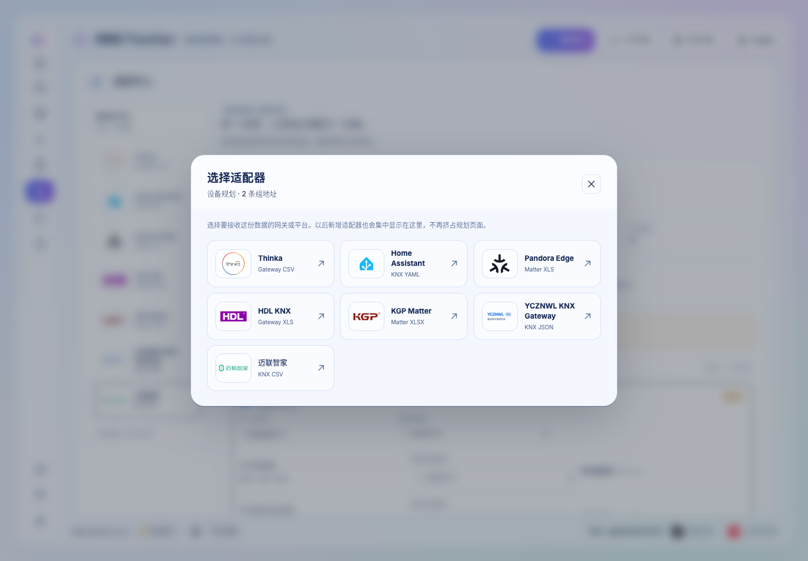

# KNX FlowGen 2.0

**规划更清晰，交付更从容。**

面向 KNX 工程师、智能家居集成商与现场调试人员的 Windows 组地址规划与交付工具。从设备规划、现场记录和 ETS6 XML 出发，完成网关适配、项目检查与工程交付。

[软件下载](https://github.com/appleyancheng-art/KNX-FlowGen/releases) · [官方网站与在线体验](http://knxflowgen.top:9920/ff/) · [购买激活码](https://68n.cn/E3Snb) · [中文手册](docs/KNX_FlowGen_User_Manual_CN.pdf) · [English manual](docs/KNX_FlowGen_User_Manual_EN.pdf)

## 从一份数据，到完整交付

- **设备规划**：按设备与功能生成组地址，支持排序、批量命名、功能改名、地址占用检查与起始地址建议。
- **批量规划**：把多个房间、设备与批次统一组织，生成 ETS6 组地址 XML。
- **精装房现场记录**：下载 Excel 模板，记录现场抓取的组地址、设备与 DPT；导入后校对、二次编辑，再输出 XML、网关文件与交付清单，减少重复整理。
- **ETS6 XML 转译**：导入已有组地址 XML，结合名称与 DPT 辅助识别设备和功能；保留原地址，复核后继续转换。
- **适配中心**：统一选择数据来源和设备，按目标网关模板生成文件。
- **项目交付**：独立检查与 PDF / Excel 清单，组合规划、批量和导入来源。
- **使用体验**：中英文、深浅色模式、模板管理、项目保存与功能引导。

## 网关与平台

| 平台 / 网关 | 输出 |
| --- | --- |
| Thinka | Gateway CSV |
| Home Assistant | KNX YAML |
| Pandora Edge Matter | XLS 模板 |
| HDL KNX | XLS 模板 |
| KGP Matter | 中英双语 XLSX 模板 |
| YCZNWL KNX Gateway（宜巢） | 设备 JSON |
| Morelinks 迈联智家 | 名称后缀规则 CSV |

各适配器按已有文档或提供的模板映射。支持范围和必填参数随平台不同；请核对 DPT、读写方向、房间与设备参数。宜巢与迈联新增适配须先少量实机验证，详见 [适配补充说明](docs/ADAPTERS.md)。

## 下载与使用

1. 打开 [Releases](https://github.com/appleyancheng-art/KNX-FlowGen/releases)，下载 `.exe` 安装包。
2. 保存项目并退出旧版后再安装。Windows 10 / 11 为主要使用目标，需安装 Edge 或 Chrome 109+。
3. 按软件提示激活。购买与授权规则以[购买页面](https://68n.cn/E3Snb)为准。
4. 从设备规划或现场记录 / ETS6 XML 导入开始；完成检查后再导出。

当前安装包未代码签名，Windows 可能显示安全提示。GitHub 的 `Source code (zip)` 是本展示仓库的文档归档，不是软件安装包。带 **Pre-release** 标识的构建为测试候选版，请先验证再用于项目。

## 手册与更新

- [中文用户手册 PDF](docs/KNX_FlowGen_User_Manual_CN.pdf)
- [English User Manual PDF](docs/KNX_FlowGen_User_Manual_EN.pdf)
- [适配器补充与使用边界](docs/ADAPTERS.md)
- [2.0 更新记录](CHANGELOG.md)
- [常见问题](docs/FAQ.md)

## 联系与购买

作者：**做智能的姚老师**  
[购买激活码](https://68n.cn/E3Snb) · [抖音主页](https://v.douyin.com/2S7WNUvxeYs/) · [官网联系方式](http://knxflowgen.top:9920/ff/#contact)

问题反馈可在 [Issues](https://github.com/appleyancheng-art/KNX-FlowGen/issues) 提交。请附版本、操作步骤和脱敏截图，勿公开激活码、客户工程文件或个人信息。

## 使用与品牌

本仓库用于软件介绍、文档与安装包分发。**KNX FlowGen 是需要授权的软件，本仓库公开不代表程序源码开源。** 第三方品牌与标识属于各自权利人；列出适配不代表官方认证或合作关系。

---

**English:** KNX FlowGen is a Windows tool for KNX group-address planning, field-record imports, ETS6 XML conversion, gateway adaptation, and project handover. Find the installer in Releases, read the English manual, and review gateway-specific limitations before importing into a real system. This is the public product/documentation repository, not an open-source distribution of the application.
